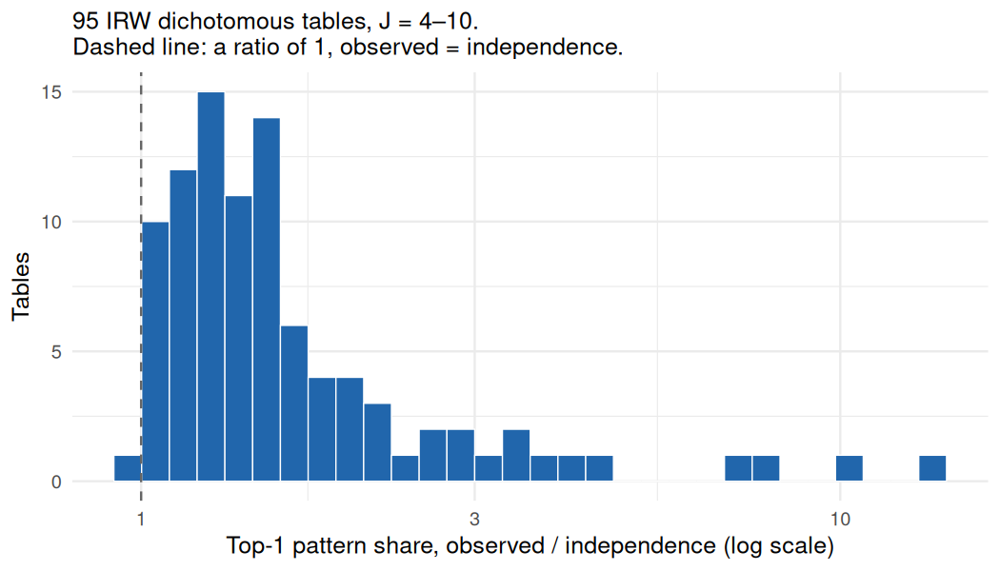

# How concentrated are IRW answer patterns?

Run 2026-11-02 over the 95 usable main-stratum tables of `gapshare_tables.csv`, IRW v616 pinned: `item_response_warehouse=v75.0; item_response_warehouse_2=v34.0; item_response_warehouse_3=v14.0; item_response_warehouse_4=v15.0; item_response_warehouse_5=v10.0; item_response_warehouse_6=v5.11; irw_simsyn=v1.4; irw_competitions=v6.3; irw_nominal=v5.0; irw_meta=v47.0; irw_text=v38.0`.
Pin caveat: IRW v616 contains 7 dataset(s) this version of the package does not know about: item_response_warehouse_7, item_response_warehouse_8, irw_text_2, irw_text_3, irw_conjoint, irw_conjoint_2, irw_rank. They cannot be pinned or read here; update the package.
Seed 20260222. In-sample fits from `fit_three()`; every refit matched the recorded log-likelihoods (largest absolute difference 0.012).

Distributions: `obs` = observed pattern frequencies; `ind` = fitted independence;
`rq` = fitted rank-1 log-quadratic. Entropy H is in bits over all 2^J patterns;
`eff` = 2^H, the effective number of patterns. `top1_ratio` = top1_obs / top1_ind.
`multi_info_bits` = H_ind − H_obs. `rq_share_of_multi` = (H_ind − H_rq)/(H_ind − H_obs).
`frac_observed` = share of the 2^J patterns seen at least once, J ≥ 8 only.

## Median [IQR], overall and by J

| statistic | all (n = 95) | J = 4 (22) | J = 5 (26) | J = 6 (17) | J = 7 (9) | J = 8 (9) | J = 9 (7) | J = 10 (5) |
|---|---|---|---|---|---|---|---|---|
| `top1_obs` | 0.397 [0.240, 0.612] | 0.510 [0.434, 0.669] | 0.381 [0.302, 0.516] | 0.317 [0.205, 0.553] | 0.310 [0.167, 0.486] | 0.239 [0.124, 0.324] | 0.838 [0.811, 0.851] | 0.0510 [0.0385, 0.110] |
| `top1_ind` | 0.268 [0.109, 0.436] | 0.359 [0.323, 0.526] | 0.266 [0.184, 0.370] | 0.210 [0.106, 0.338] | 0.102 [0.0630, 0.121] | 0.104 [0.0635, 0.195] | 0.764 [0.679, 0.773] | 0.0359 [0.0313, 0.0724] |
| `top1_rq` | 0.388 [0.222, 0.608] | 0.499 [0.435, 0.662] | 0.372 [0.297, 0.508] | 0.288 [0.167, 0.531] | 0.271 [0.153, 0.447] | 0.240 [0.122, 0.294] | 0.820 [0.797, 0.836] | 0.0576 [0.0290, 0.0996] |
| `top5_obs` | 0.765 [0.598, 0.896] | 0.880 [0.826, 0.961] | 0.773 [0.639, 0.886] | 0.704 [0.551, 0.811] | 0.649 [0.506, 0.734] | 0.603 [0.397, 0.639] | 0.934 [0.909, 0.937] | 0.202 [0.153, 0.432] |
| `top5_ind` | 0.691 [0.389, 0.876] | 0.857 [0.764, 0.913] | 0.699 [0.556, 0.822] | 0.555 [0.394, 0.696] | 0.335 [0.218, 0.384] | 0.346 [0.267, 0.501] | 0.937 [0.884, 0.941] | 0.140 [0.118, 0.276] |
| `top5_rq` | 0.769 [0.579, 0.899] | 0.885 [0.822, 0.939] | 0.774 [0.626, 0.868] | 0.667 [0.472, 0.811] | 0.623 [0.487, 0.694] | 0.576 [0.390, 0.631] | 0.936 [0.915, 0.939] | 0.188 [0.120, 0.417] |
| `H_obs` | 3.00 [2.11, 4.07] | 2.31 [1.77, 2.53] | 2.91 [2.51, 3.64] | 3.27 [2.91, 4.28] | 4.10 [3.44, 4.74] | 4.42 [3.90, 5.30] | 1.26 [1.25, 1.51] | 6.94 [5.23, 7.15] |
| `H_ind` | 3.60 [2.57, 4.90] | 2.66 [2.33, 3.10] | 3.50 [2.80, 4.04] | 4.23 [3.60, 4.92] | 5.56 [5.33, 5.92] | 5.73 [4.89, 6.34] | 1.54 [1.49, 2.07] | 7.62 [6.61, 8.03] |
| `H_rq` | 3.00 [2.13, 4.26] | 2.34 [1.84, 2.55] | 2.93 [2.52, 3.73] | 3.61 [2.95, 4.47] | 4.30 [3.52, 4.82] | 4.61 [3.95, 5.50] | 1.30 [1.28, 1.58] | 7.11 [5.34, 7.77] |
| `eff_obs` | 7.98 [4.31, 16.8] | 4.97 [3.41, 5.78] | 7.54 [5.70, 12.5] | 9.68 [7.51, 19.5] | 17.1 [10.9, 26.8] | 21.4 [14.9, 39.4] | 2.40 [2.37, 2.86] | 123. [37.6, 142.] |
| `eff_ind` | 12.1 [5.95, 29.8] | 6.35 [5.03, 8.60] | 11.3 [6.96, 16.5] | 18.8 [12.1, 30.3] | 47.1 [40.2, 60.5] | 53.1 [29.6, 80.7] | 2.90 [2.81, 4.35] | 197. [97.7, 262.] |
| `eff_rq` | 7.99 [4.38, 19.2] | 5.06 [3.57, 5.86] | 7.63 [5.75, 13.3] | 12.2 [7.73, 22.2] | 19.8 [11.4, 28.3] | 24.4 [15.5, 45.2] | 2.47 [2.43, 3.01] | 139. [40.5, 218.] |
| `top1_ratio` | 1.44 [1.22, 1.79] | 1.40 [1.12, 1.46] | 1.52 [1.24, 1.83] | 1.49 [1.22, 1.77] | 1.71 [1.28, 4.43] | 1.65 [1.34, 2.06] | 1.11 [1.11, 1.22] | 1.52 [1.42, 1.57] |
| `multi_info_bits` | 0.447 [0.258, 0.804] | 0.322 [0.143, 0.499] | 0.353 [0.235, 0.571] | 0.609 [0.355, 0.776] | 1.07 [0.628, 1.98] | 0.961 [0.700, 1.27] | 0.290 [0.283, 0.559] | 0.682 [0.655, 1.38] |
| `rq_share_of_multi` | 0.912 [0.812, 0.951] | 0.953 [0.913, 0.974] | 0.934 [0.853, 0.954] | 0.893 [0.826, 0.917] | 0.905 [0.851, 0.924] | 0.732 [0.717, 0.914] | 0.822 [0.818, 0.860] | 0.661 [0.501, 0.745] |
| `frac_observed` | 0.387 [0.330, 0.629] | — | — | — | — | 0.586 [0.414, 0.707] | 0.330 [0.313, 0.399] | 0.376 [0.249, 0.387] |

Per-J columns rest on few tables (counts in the header). Where one source family
makes up half or more of a J, the column describes that family more than the J:

- J = 9: 4 of 7 tables are `mexico_*`

## Identity of the top pattern

- observed: all0 37, all1 32, other 26
- independence: all0 28, all1 24, other 43
- rank-1: all0 36, all1 31, other 28
- tables where the top cell is tied (identity arbitrary): obs 0, ind 0, rq 0

## Coverage for J ≥ 8

| table | J | N | 2^J | observed | fraction |
|---|---|---|---|---|---|
| `ganbat_2022_pollution_symptoms` | 8 |   1,328 | 256 | 167 | 0.652 |
| `rzeszutek_2023_pds5_events` | 8 |   1,598 | 256 | 90 | 0.352 |
| `busch_2023_stigma` | 8 |   1,740 | 256 | 115 | 0.449 |
| `mistry_2022_hardship` | 8 |   1,772 | 256 | 150 | 0.586 |
| `argentina_2012_aging_dependence` | 8 |   4,654 | 256 | 90 | 0.352 |
| `perez_hernandez_2021_elcsa` | 8 |   4,799 | 256 | 181 | 0.707 |
| `mobility` | 8 |   8,445 | 256 | 106 | 0.414 |
| `gilbert_meta_39` | 10 |   5,336 | 1024 | 385 | 0.376 |
| `onah_2021_covid_info_sources` | 10 |   7,890 | 1024 | 183 | 0.179 |
| `przybylski_2016_igd` | 10 |   7,041 | 1024 | 396 | 0.387 |
| `argentina_2013_reproductive_awareness` | 10 |   9,785 | 1024 | 255 | 0.249 |
| `mexico_2024_q4safety_harassment` | 9 |  23,419 | 512 | 155 | 0.303 |
| `mexico_2025_q2safety_harassment` | 9 |  23,689 | 512 | 169 | 0.330 |
| `mexico_2025_q4safety_harassment` | 9 |  23,875 | 512 | 166 | 0.324 |
| `mexico_2024_q2safety_harassment` | 9 |  24,084 | 512 | 181 | 0.354 |
| `argentina_2017_victimization_disorder` | 9 |  20,617 | 512 | 393 | 0.768 |
| `colombia_2023_politics_media` | 8 |  29,436 | 256 | 216 | 0.844 |
| `colombia_2023_politics_attitudes` | 8 |  42,088 | 256 | 229 | 0.895 |
| `colombia_2023_politics_risks` | 9 |  46,392 | 512 | 228 | 0.445 |
| `gilbert_meta_6` | 10 |  11,874 | 1024 | 644 | 0.629 |
| `ecuador_2011_safety_crime` | 9 | 117,737 | 512 | 126 | 0.246 |

## Cross-check: ALSECYPIAMH_WU_2022_NEI

- top-1 share obs / ind / rq: 0.317 / 0.110 / 0.307  (expected 0.317 / 0.110 / 0.307)
- effective patterns obs / ind / rq: 14.2 / 22.8 / 14.4  (expected 14.2 / 22.8 / 14.4)

## Top-1 ratio

