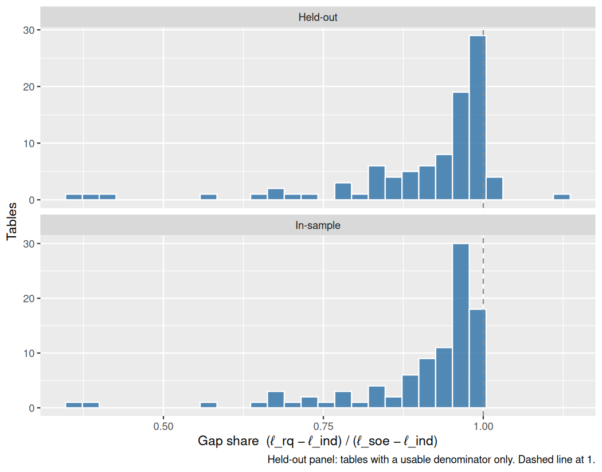
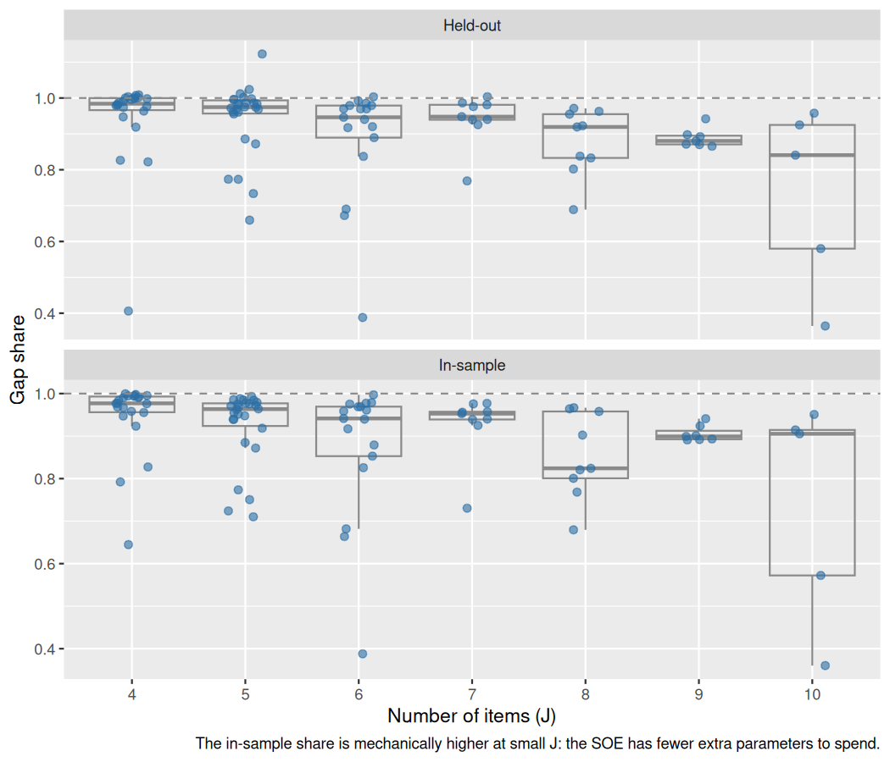
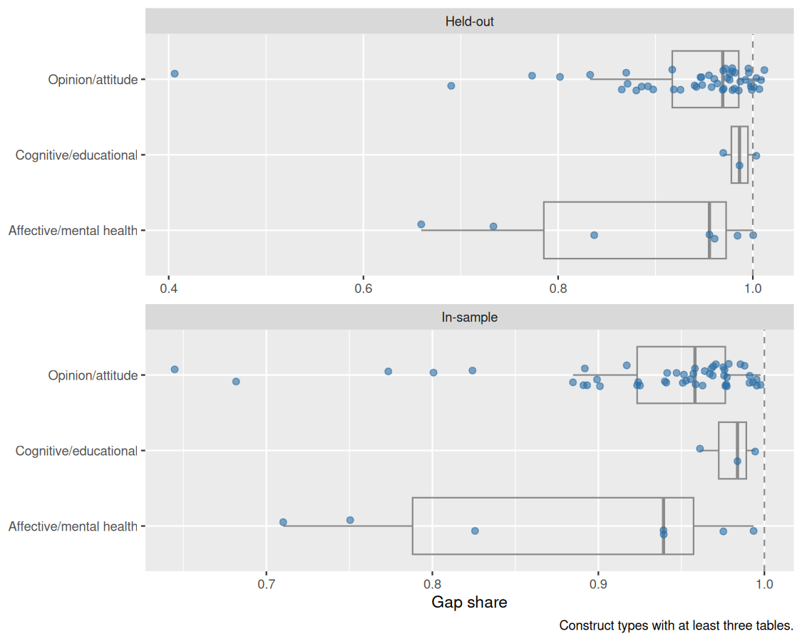

# How much of pairwise association does one latent dimension explain?

Run 2026-10-22. IRW versions pinned: `item_response_warehouse=v75.0; item_response_warehouse_2=v34.0; item_response_warehouse_3=v14.0; item_response_warehouse_4=v15.0; item_response_warehouse_5=v10.0; item_response_warehouse_6=v5.11; item_response_warehouse_7=v1.4; item_response_warehouse_8=v2.0; irw_text=v38.0; irw_text_2=v18.0; irw_text_3=v7.0; irw_meta=v47.0; irw_nominal=v5.0; irw_competitions=v6.3; irw_simsyn=v1.4; irw_conjoint=v4.2; irw_conjoint_2=v1.5; irw_rank=v1.5`.
Pin caveat: IRW v616 contains 7 dataset(s) this version of the package does not know about: item_response_warehouse_7, item_response_warehouse_8, irw_text_2, irw_text_3, irw_conjoint, irw_conjoint_2, irw_rank. They cannot be pinned or read here; update the package.
Seed 20260222, 5-fold CV over respondents.

## Quantity

For each table, three nested loglinear models are fitted to the 2^J pattern
counts (zero cells included): independence (J+1 parameters), the restricted
log-quadratic with rank-1 Γ (2J+1), and the full SOE (1+J+J(J−1)/2). The gap
share is (ℓ_rq − ℓ_ind) / (ℓ_soe − ℓ_ind).

In sample the share is bounded in [0,1] and is inflated at small J. The
held-out version uses 5-fold CV over respondents, summing the multinomial
log-likelihood of each held-out fold under models fitted on the other four.

**The held-out ratio is reported only where its denominator is usable.** Out
of sample the SOE can score worse than independence; the ratio then flips
sign and means nothing. The primary numbers are the per-held-out-respondent
log-likelihood gaps in nats, which stay interpretable either way.

Fitted cell probabilities are floored at 1/(10·N_train) before held-out
evaluation, so a single respondent landing in a numerically empty cell cannot
dominate a fold. Unfloored values are in the CSV.

## Coverage

- tables considered: 111
- usable: 95
- flagged (glm warning, non-convergence, or |coef| > 15): 17
- held-out denominator usable: 95 of 95

Exclusion reasons (`gapshare_excluded.csv`):

- `J = …`: 9
- `N = …`: 6
- `repeated id-item rows (trial-level)`: 1

## Headline

| | n | median | IQR |
|---|---|---|---|
| in-sample, all | 95 | 0.953 | [0.891, 0.976] |
| in-sample, unflagged | 78 | 0.957 | [0.903, 0.977] |
| **held-out, all** | 95 | **0.963** | [0.883, 0.986] |
| held-out, unflagged | 78 | 0.969 | [0.919, 0.986] |

Per held-out respondent (nats, floored), median over usable tables:

- rank-1 over independence: 0.2349
- full SOE over independence: 0.2515
- what the SOE adds beyond rank-1: 0.0114

## Against J

   J  n med_in n_out med_out
1  4 22  0.977    22   0.984
2  5 26  0.963    26   0.974
3  6 17  0.941    17   0.946
4  7  9  0.953     9   0.948
5  8  9  0.824     9   0.919
6  9  7  0.899     7   0.880
7 10  5  0.905     5   0.841

## By construct type

                                        construct_type  n med_in n_out med_out
1                                     Opinion/attitude 49  0.958    49   0.969
2                                           (untagged) 25  0.919    25   0.939
3                              Affective/mental health  7  0.939     7   0.955
4                                Cognitive/educational  3  0.984     3   0.986
5            Affective/mental health, Opinion/attitude  2  0.978     2   0.982
6                                           Behavioral  2  0.983     2   0.986
7                  Affective/mental health, Behavioral  1  0.976     1   1.024
8  Behavioral, Cognitive/educational, Opinion/attitude  1  0.572     1   0.580
9                         Behavioral, Opinion/attitude  1  0.664     1   0.672
10             Cognitive/educational, Opinion/attitude  1  0.730     1   0.769
11                        Cognitive/educational, Other  1  0.905     1   0.925
12                                       Developmental  1  0.973     1   0.974
13                                         Personality  1  0.388     1   0.388

## Lowest held-out share (unflagged)

                           table  J     N share_in share_out_floor
1   onah_2021_covid_info_sources 10  7890    0.360           0.364
2  spain_2017_politics_agreement  4  1927    0.645           0.406
3                 gilbert_meta_6 10 11874    0.572           0.580
4 teicher_2015_mace_phys_neglect  5  1050    0.750           0.659
5                           wirs  6  1005    0.664           0.672
  cv_gap_rq_nats cv_gap_soe_nats
1          0.071           0.196
2          0.011           0.028
3          0.181           0.311
4          0.072           0.110
5          0.147           0.218
                                       construct_type
1                                                <NA>
2                                    Opinion/attitude
3 Behavioral, Cognitive/educational, Opinion/attitude
4                             Affective/mental health
5                        Behavioral, Opinion/attitude
            measurement_tool
1       Survey/questionnaire
2       Survey/questionnaire
3 Survey/questionnaire, Test
4       Survey/questionnaire
5       Survey/questionnaire

- **onah_2021_covid_info_sources** — the ten 'items' are COVID information **sources** (church/mosque, radio, NCDC/WHO/UNICEF websites, newspapers, social media, television, health worker, friends and family), not indicators of a trait; official-website use and interpersonal sources are separate clusters, so multi-cluster pairwise structure is built in
- **spain_2017_politics_agreement** — the weakest association in the set -- the full SOE beats independence by only 0.028 nats per held-out respondent, so the share is a ratio of two small numbers and is correspondingly unstable; a low share here means 'little to explain', not 'rank-1 fails'
- **gilbert_meta_6** — Bruhn (2016) financial literacy, using the authors' dummy-coded items (`data/gilbert_hte/il_hte_06.R`); the ten items span separate sections of the instrument and the A/B suffixes mark sub-parts of shared parent questions, both routes to local dependence
- **teicher_2015_mace_phys_neglect** — the MACE physical-neglect subscale mixes material deprivation (no food, dirty clothes) with supervision and protection (parent in ER, parent protects, looked out for each other) -- distinct facets inside one short subscale, i.e. testlet structure; N = 1,050 is also the smallest here, so the SOE's interaction parameters are poorly determined
- **wirs** — the WIRS data from the `ltm` package: six binary items on which channels management uses to consult employees; distinct consultation channels are not indicators of a single latent propensity

Note that 9 of the 95 usable tables have a held-out SOE-over-independence gap below 0.05 nats per respondent. The share is a ratio there, so it is noisy even though the denominator is positive; read those rows alongside `cv_gap_soe_nats`.

## J > 10 stratum (10 items drawn at random, 5 draws per table)

265 draws across 53 tables. Held-out share median 0.946, IQR [0.894, 0.971]. Spread WITHIN a table across draws: median range 0.057, max 0.391.

Reported separately and not pooled with the main result: which ten items are drawn moves the answer.

**Partial coverage.** The stratum had 170 candidate tables; 83 were attempted and 53 yielded usable draws. Candidates are processed in ascending order of total responses, so what is here is the smaller-volume end of the stratum and what is missing is the large end (the `enem_*_1mil_*` family at ~1M respondents, `choi_2020_ednet_*`). This is a truncated sample, not a random one: read it as a demonstration that the answer moves with the item draw, not as an estimate for J > 10 tables as a class.

